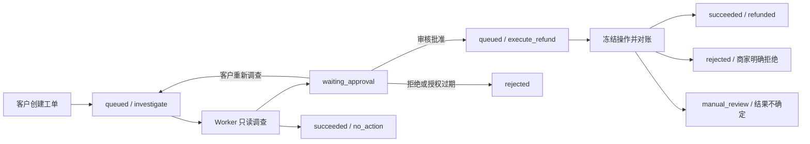

# 产品架构

Aftercare Agent 是一个持久化售后任务后端：客户提交订单问题，模型通过只读工具调查，审核员批准结构化退款方案，确定性执行器完成模拟退款与对账。
演示规则限定为已支付、未退款、物流延误至少七天、金额不超过 100000 分的 CNY 订单全额退款；订单和资金均为模拟数据。

## 组件与职责

| 组件 | 职责 | 实现入口 |
| --- | --- | --- |
| REST API | 身份校验、任务查询、幂等命令、审批与 SSE；请求处理不调用模型或商家 | [api.py](../src/aftercare/api.py) |
| Worker | 持久队列领取、心跳、并发限制、阶段分派、审批过期扫描 | [worker.py](../src/aftercare/worker.py) |
| 调查循环 | 恢复模型动作、调用只读工具、校验证据、提交方案或无需处理结果 | [agent/runner.py](../src/aftercare/agent/runner.py) |
| 运行时 | 租约校验、步骤预扣预算、检查点、持久重试 | [runtime/](../src/aftercare/runtime/) |
| 退款执行器 | 冻结授权、查询原键、同键发送、校验凭证、有限对账 | [refunds/executor.py](../src/aftercare/refunds/executor.py) |
| PostgreSQL | 队列、步骤、审批、操作、事件、命令响应；事务、约束与不可变触发器 | [models.py](../src/aftercare/models.py)、[迁移](../migrations/versions/0001_initial.py) |
| 模拟商家 | 订单与物流查询、幂等退款账本、独立资格校验 | [mock_merchant/](../src/mock_merchant/) |

部署由 API、Worker、模拟商家和 PostgreSQL 组成。API 与 Worker 使用 `app` 数据权限，商家使用 `merchant` 数据权限。
Worker 持有商家连接；HTTP 模型模式另建模型连接及凭据。API 不持有退款执行能力。
默认使用确定性 MockProvider；HttpProvider 适配 `/chat/completions`，其工具调用仍经过相同后端校验。

## 任务与持久记录

`tasks` 保存阶段、状态、代次、检查点、预算和租约；`steps` 用 `(task_id, generation, step_no)` 唯一定位逻辑步骤。
`approvals` 每代最多一份方案；`refund_operations` 每个任务最多一项冻结退款操作。
`events` 记录每任务递增的序号；`command_requests` 保存 API 幂等键、请求哈希及原业务响应。
调查错误可结束为 `failed` 或 `rejected`；已有退款操作后的非确定异常进入 `manual_review`。
状态、关联业务记录和事件在同一短事务提交，模型与商家 HTTP 调用位于事务之外。

## 调查与证据边界

模型只有 `get_order`、`get_shipment`、`get_refund_policy` 三个只读工具。
工具参数为空，订单和客户由任务上下文提供；模型不能指定其他订单、客户、URL 或退款请求。
模型输出须符合动作 Schema，一次只能选一个工具或一个最终建议。
最终建议必须引用当前工单、当前代次、三个工具各自最新成功步骤，且订单与物流版本一致。
程序按 [policy.py](../src/aftercare/refunds/policy.py) 重新判断资格，并从已验证快照派生金额、币种和版本。
`no_action` 也需要完整证据；不符合规则时的说明由程序生成。
版本不一致会反馈并重新查询；持续不一致耗尽预算时以 `SNAPSHOT_UNSTABLE` 结束。
第二次非法模型输出结束为 `INVALID_MODEL_OUTPUT`，不会绕过规则生成授权。

## 审批与不可变授权

调查完成时原子创建方案、转入 `waiting_approval` 并写入 `approval.requested`；这一阶段不创建退款操作。
方案绑定任务、代次、客户、订单、金额、币种、订单版本、规则版本和排序后的证据步骤 ID。
规范 JSON 哈希绑定方案内容，审批有效期为数据库当前时间后 24 小时。
数据库触发器禁止修改方案内容、哈希、摘要、有效期及身份关联；审批状态与决定记录允许按业务流程更新。
审核员决定须同时匹配当前代次、方案哈希、待审批状态及有效期，锁顺序固定为 task → approval。
批准只将任务排入退款执行阶段；拒绝结束任务，API 均不发送退款 HTTP。
客户仅在 `waiting_approval` 时可重新调查，最多三代；旧审批失效，新代预算及检查点重新初始化，旧步骤和事件保留。
审批与重新调查竞争时只有一个命令能提交，另一方收到冲突响应。
执行器冻结操作前再次验证授权；未冻结的过期授权会被拒绝，已冻结操作继续使用原请求对账。

## 幂等命令与退款对账

创建、审批、重新调查的命令键按客户或审核员身份及路由划分作用域。
同键同参重放原业务响应；同键异参返回 409。幂等记录与业务变更同事务提交，后续状态变化不改写原响应。
退款操作键固定为 `refund:{task_id}:{generation}`，冻结请求、请求哈希、授权关联和 120 秒对账期限。
数据库触发器禁止修改这些字段；后续恢复不能更换金额、订单或授权。
部分唯一索引使 `prepared`、`unknown`、`confirmed` 操作持续占用订单，防止另一个工单另建退款；`declined` 释放占用。

执行器每次恢复先 GET 查询原键。只有商家明确返回 missing，才允许用同键、同参 POST。
发送前先持久化 `unknown`、发送计数和事件，因此发送后崩溃仍会按原键查询。
成功或拒绝响应必须通过 Schema、操作键和请求哈希校验；成功凭证还须匹配订单、金额、币种及退款 ID。
商家账本同键同参重放结果、同键异参冲突，并对同订单成功退款施加唯一约束。
最多三次 POST、八次 GET；单次 HTTP 最长五秒，并受剩余对账期限限制。
不确定响应按 2、4、8、16、30、30 秒持久退避，POST 用完仍继续查询，最后一次 GET missing 后不再发送。
次数或期限耗尽转入 `manual_review`，保留原操作和订单占用；超时不被解释为确定退款失败。
`inspect-refund` 仅查看本地记录并 GET 原键，不改账本、任务或事件，也不自动解除人工核对状态。

## 租约、步骤与崩溃恢复

Worker 用 `FOR UPDATE SKIP LOCKED` 领取到期 queued 或租约过期 running，锁定后读取数据库时间并增加 epoch。
每次写回都重新验证 owner、epoch、running 状态及未过期租约；过期租约不能通过续租复活。
心跳失败取消 handler，后续 Worker 可接管；关闭时停止领取，最多等待十秒后取消未完成处理。
模型或只读工具调用前提交 pending 步骤并预扣预算，返回后再验证租约和尝试编号，原子保存结果、检查点与事件。
成功步骤直接复用输出；pending 步骤保留原选择和输入，旧尝试不能覆盖新尝试。
恢复已保存的模型动作时继续其工具调用，恢复最终建议时重新提交业务结果，不重新询问模型替换已提交选择。
每代调查限 180 秒、八次实际模型请求、六个工具逻辑步骤；远程步骤最多三次尝试。
模型调用最长三十秒，工具最长五秒；恢复不清空已消耗预算。
检查点保存已提交动作和结果，不保存模型隐藏推理；模型输出、工具输出、检查点分别限制为 8、16、128 KiB。

租约只能拒绝旧 Worker 的本地写回，无法撤回已发送的 HTTP。
外部退款防重依赖同键同参以及商家幂等账本；本地事务与外部 HTTP 之间没有跨系统原子提交。
恢复流程通过查询原键解决响应丢失和外部成功后本地未提交的窗口。

## 事件、访问与可观测性

客户只读取自己的工单，审核员可查询全部工单；不存在与不可见工单统一返回 404。
事件序号在持有 task 行锁的事务内分配，与状态变更一起提交或回滚。
SSE 先读取当前状态及序号上界 H，再按 `cursor < seq <= H` 有序分批读取，每批最多一百条。
客户端通过 `Last-Event-ID` 重连；游标须为非负 int64 ASCII 整数，超过当前序号返回 409。
终态追平 H 后关闭连接；等待时每秒轮询，每十五秒发送注释心跳，等待和发送期间不持有数据库事务。
结构化日志保存关联 ID、代次、epoch、步骤、操作键、事件序号、固定错误码和耗时，不记录凭据或外部响应原文。
`event_staged` 日志发生在提交前，事务可能随后回滚；已提交数据库事件是权威记录。

## 可验证范围

并发领取、过期租约、审批竞争、不可变约束、事务回滚和预算由真实 PostgreSQL 集成测试覆盖。
真实 TCP 与进程测试覆盖 SSE 重连及心跳、调查步骤完成后强杀、退款发送前强杀、外部成功后本地提交前强杀。
测试入口与场景映射见 [验收对照](acceptance.md)，执行细节见 [运行时说明](runtime.md)。
HttpProvider 已有协议契约测试；真实模型的建议质量和外部模型服务兼容性尚未获得端到端验证。
产品当前使用模拟商家与静态 Token 身份；真实支付接入、注册登录、多租户、部分退款和人工补账接口不在现有实现范围内。
